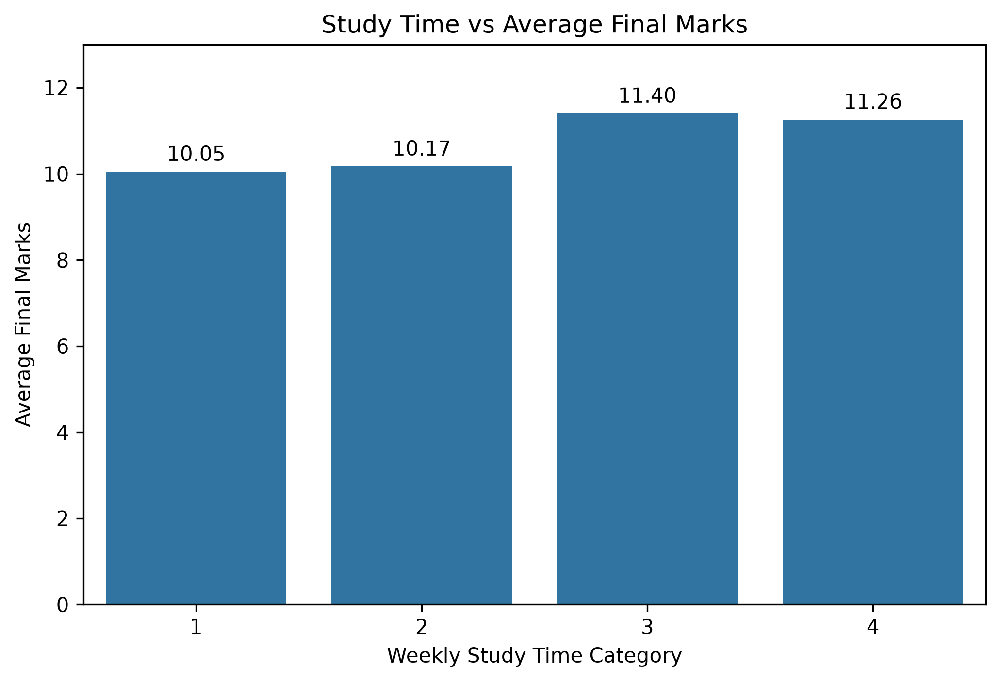
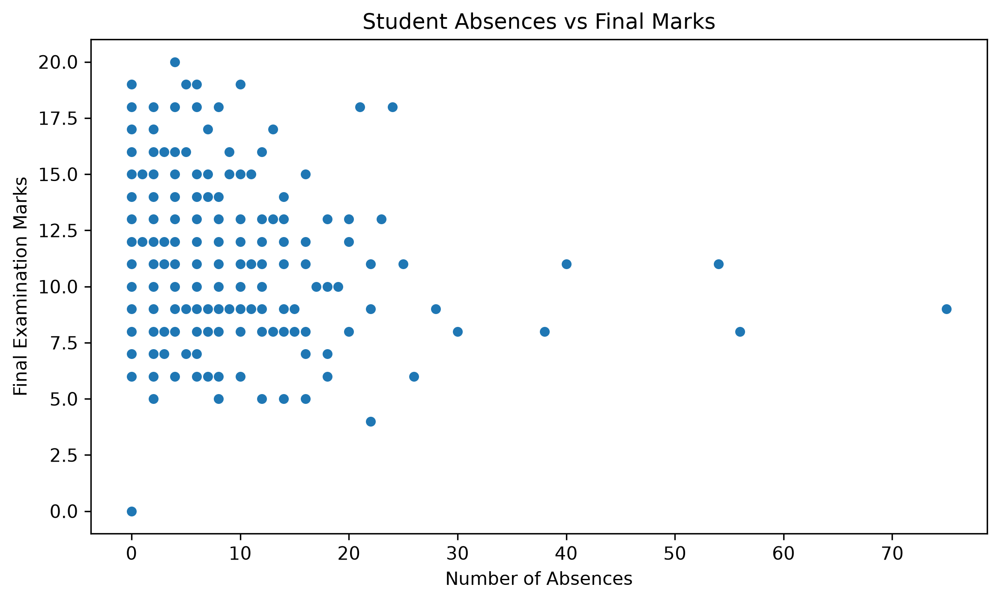
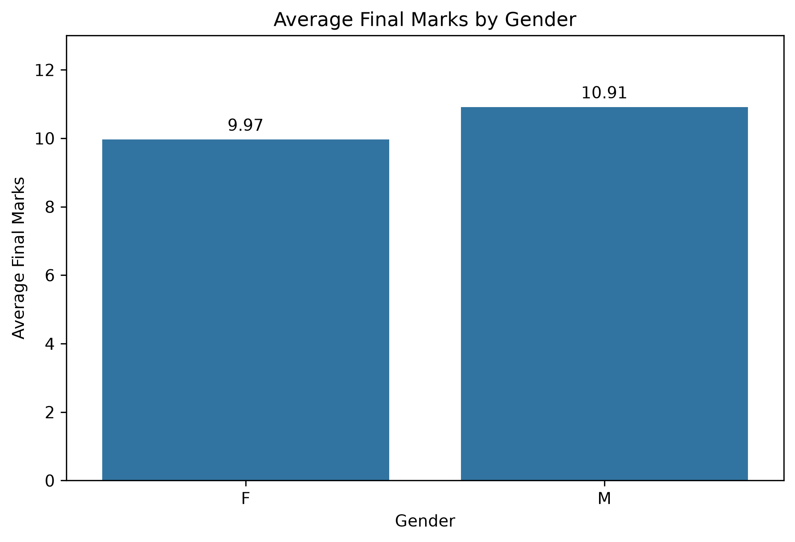
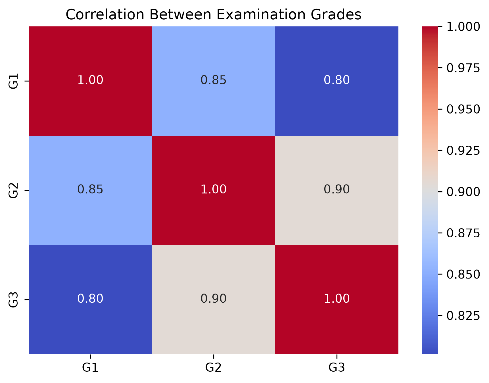
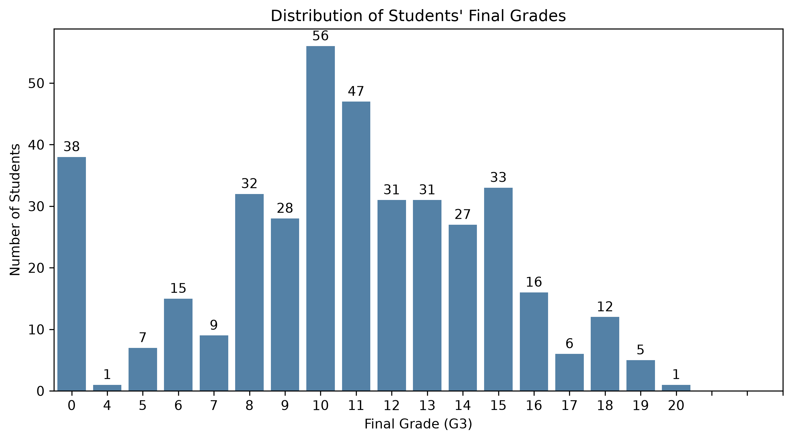
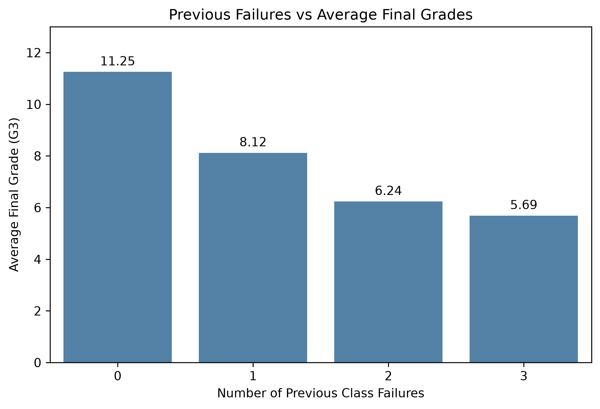
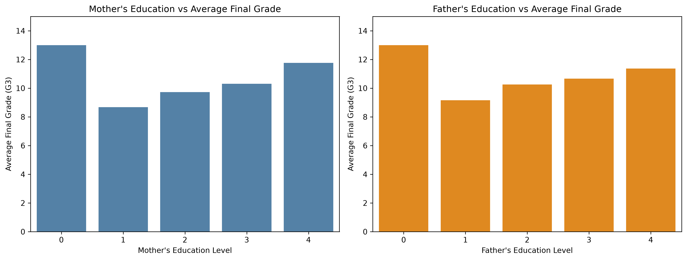
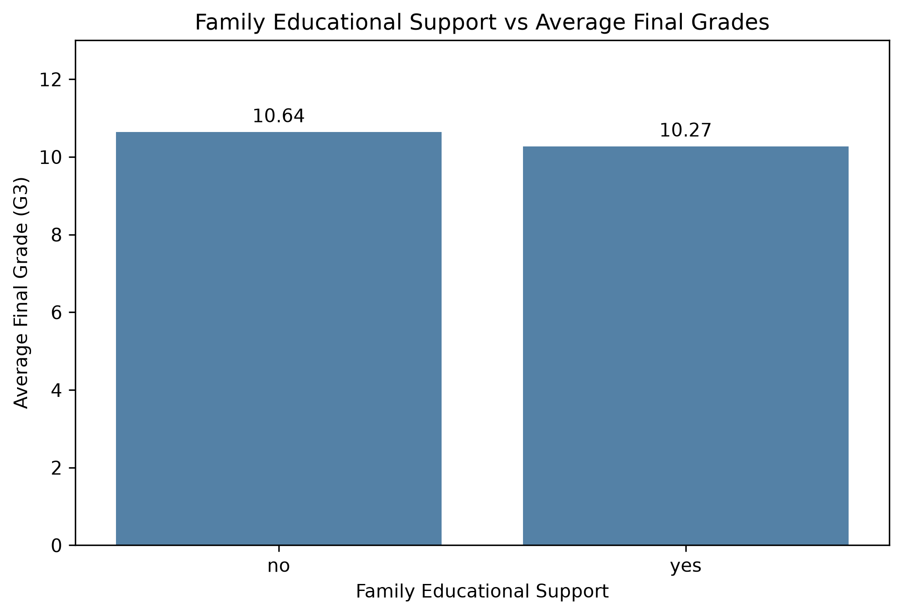
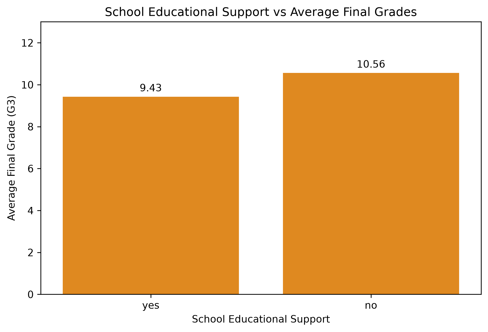
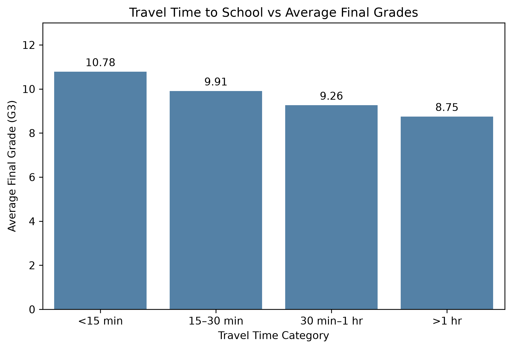

# Student Performance Analysis Using Python

## About the Project

An Exploratory Data Analysis (EDA) project that investigates student academic performance using Python. It explores how study habits, previous grades, family background, educational support, and travel time relate to students' final Mathematics grades.

## Dataset

- **Source:** UCI Machine Learning Repository
- **Dataset:** Student Performance (Mathematics)
- **Records:** 395 students
- **Features:** 33 attributes
- **Target Variable:** G3 (Final Mathematics Grade)
- **Grade Range:** 0–20

## Technologies Used

- Python
- Pandas
- NumPy
- Matplotlib
- Seaborn
- Jupyter Notebook

## Project Structure

```text
Student_Performance_Analysis/
│
├── dataset/
│   └── student-mat.csv
│
├── Notebook/
│   └── Student_Performance_Analysis.ipynb
├── Visualizations/
│
├── requirements.txt
└── README.md
```

## Key Analysis Areas

- Study time vs final grades
- Absences vs final grades
- Gender-based performance analysis
- Correlation between examination grades
- Previous failures vs final grades
- Parental education vs student performance
- Family and school educational support
- Travel time to school vs final grades
- Final grade distribution

## Key Findings

- G2 has a strong positive correlation with G3.
- Students with more previous failures generally have lower average final grades.
- Study-time categories show differences in average performance.
- Longer travel-time categories show lower average grades.
- Absences have almost no linear correlation with final grades in this dataset.

## Project Visualizations

### 1. Study Time vs Final Grades


### 2. Absences vs Final Grades


### 3. Gender vs Final Grades


### 4. Grade Correlation Heatmap


### 5. Final Grade Distribution


### 6. Previous Failures vs Final Grades


### 7. Parental Education vs Final Grades


### 8. Family Educational Support vs Final Grades


### 9. School Educational Support vs Final Grades


### 10. Travel Time vs Final Grades


## Installation and Usage

1. Clone this repository.
2. Install the required libraries:

```bash
pip install -r requirements.txt
```

3. Open Jupyter Notebook:

```bash
jupyter notebook
```

4. Open `Notebook/Student_Performance_Analysis.ipynb` and run the cells.

## Limitations

- The dataset contains only 395 students.
- The analysis focuses on Mathematics.
- The results do not establish causation.
- Some categories have small sample sizes.

## Future Scope

- Apply Machine Learning algorithms to predict student performance.
- Explore additional datasets and subjects.
- Develop an interactive academic performance dashboard.
- Build an early-warning system for students who may need academic support.

## Project Status

Completed: Exploratory Data Analysis (EDA) and data visualization.

## Dataset Attribution

This project uses the Student Performance dataset provided by the UCI Machine Learning Repository.

**Original Author:** Paulo Cortez (2008)

**Dataset:** Student Performance – Mathematics (`student-mat.csv`)

**Source:** https://archive.ics.uci.edu/dataset/320/student+performance

**DOI:** https://doi.org/10.24432/C5TG7T

**License:** Creative Commons Attribution 4.0 International (CC BY 4.0).

The dataset is used for educational and exploratory data analysis purposes. All original dataset credit belongs to its author and the UCI Machine Learning Repository.